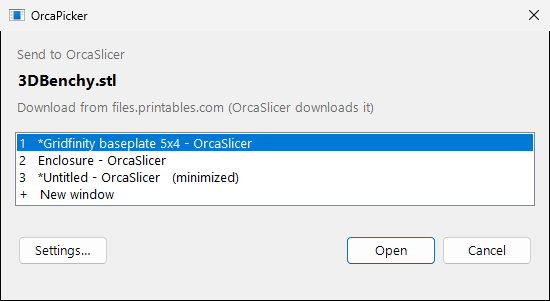
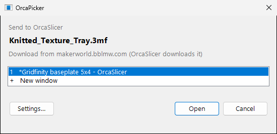
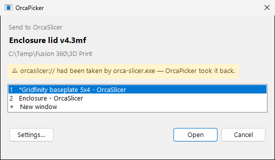
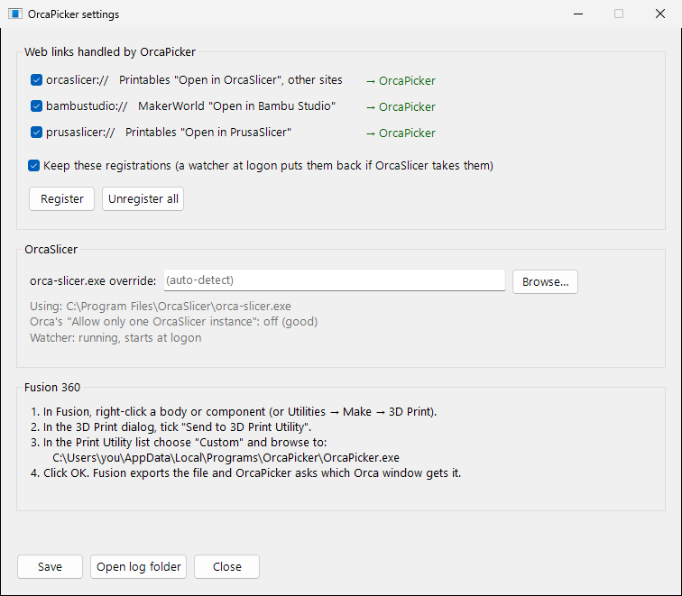

# OrcaPicker

When you click **Open in OrcaSlicer / PrusaSlicer / Bambu Studio** on a model site, or send a model
from **Fusion 360**, OrcaPicker asks which open **OrcaSlicer window** should get it, or opens a new one.

- **No Orca open:** Orca starts with the model, and no picker is shown.
- **One or more Orca windows open:** a small picker appears in front. It lists the windows by title, most
  recently used first and preselected, plus **New window**.
  - **Enter** or double-click confirms, **Esc** cancels, **1–9** picks a window, and **N** picks New window.
  - **Settings…** opens OrcaPicker's settings on top of the picker. Close settings to carry on with the pick.
- Once a model is sent, the chosen window comes to the front, restored if it was minimized.



<table>
<tr>
<td></td>
<td></td>
</tr>
<tr>
<td align="center"><sub>MakerWorld "Open in Bambu Studio", one Orca window open</sub></td>
<td align="center"><sub>Fusion 360 export, with a notice after Orca took the scheme back</sub></td>
</tr>
</table>

Links are handed to OrcaSlicer's own downloader, so Orca downloads the file. Zips, 3MF projects and
MakerWorld's importer all behave exactly as if you'd clicked the link with Orca registered directly.
OrcaPicker itself never touches the network.

How it talks to Orca is documented, with source references, in [docs/orca-ipc.md](docs/orca-ipc.md).

## Requirements

- Windows 10/11, x64. OrcaSlicer installed with the regular GitHub installer.
- In OrcaSlicer → **Preferences**:
  - **"Allow only one OrcaSlicer instance" must be OFF** (it's the default). Orca no longer accepts a
    `--no-single-instance` flag, so this preference is the only way "New window" can open a new window.
    The picker warns you if it's on.
  - **"Download folder" must be set.** Orca's downloader refuses links without it.

## Install

1. Download `OrcaPicker.exe` from the [latest release](https://github.com/Kastro5/OrcaPicker/releases/latest),
   or build it yourself (see below).
2. Put `OrcaPicker.exe` somewhere permanent, e.g. `%LOCALAPPDATA%\Programs\OrcaPicker\OrcaPicker.exe`.
   The registrations point at this exact path, so if you move it later, register again.
3. Run:

   ```powershell
   & "$env:LOCALAPPDATA\Programs\OrcaPicker\OrcaPicker.exe" --register
   ```

   This registers `orcaslicer://`, `bambustudio://` and `prusaslicer://` for your user only (HKCU, no admin).
   It saves whatever those schemes pointed to before in `%LOCALAPPDATA%\OrcaPicker\backup.json`, and
   adds the watcher at logon (see below).

Running `OrcaPicker.exe` with no arguments opens **settings** (the picker's **Settings…** button opens
it too). There you can:
- tick or untick each scheme, then Register or Unregister;
- see which program each scheme points to right now;
- set the Orca path override;
- turn the watcher on or off;
- open the log folder;
- read the Fusion 360 instructions.



### Turn off Orca's own link associations

In OrcaSlicer → Preferences → **"Associate web links to OrcaSlicer"**, untick **prusaslicer://** and
**bambustudio://** (and **cura://** if you like). If they stay ticked, Orca takes those schemes back
whenever you close its Preferences.

**orcaslicer:// can't be turned off in Orca.** It re-registers it every time it starts. That's why
OrcaPicker has the **watcher**: `OrcaPicker.exe --watch` starts at logon from `HKCU\...\Run`. It sleeps
until one of the three scheme keys changes, puts OrcaPicker back within about half a second, and does
nothing else. You can turn it off in settings. OrcaPicker also re-checks the registrations every time it
runs, and tells you when it had to take one back.

## Fusion 360

1. Right-click a body or component → **3D Print** (or **Utilities → Make → 3D Print**).
2. Tick **Send to 3D Print Utility**.
3. In the print utility list choose **Custom** → browse to `OrcaPicker.exe`.
4. Click **OK**. Fusion exports the STL/3MF and starts OrcaPicker with the file path.

## Two clicks at once

The first OrcaPicker shows its picker, and any OrcaPicker started while it's open hands its link over
and exits. Each link then gets **its own pick**, one after the other. If the first pick started a new
Orca, the next one waits for that window ("Waiting for OrcaSlicer to finish starting…"), so it can be
chosen instead of starting yet another Orca.

## Troubleshooting

- **Log:** `%LOCALAPPDATA%\OrcaPicker\log.txt`. Every raw argument is logged, so you can see exactly what
  each site sends, along with the window list and what was sent to Orca.
- `OrcaPicker.exe --diag` shows what OrcaPicker sees: the Orca exe, the single-instance preference,
  each scheme's handler and the Orca windows.
- **"Windows blocked the message to OrcaSlicer":** Orca is running as administrator. Start it normally.
- **"OrcaSlicer didn't respond":** Orca is busy (slicing, or a dialog is open). Try again.
- A link was ignored: check the log. If the site uses a format OrcaPicker doesn't recognise, the raw text
  is there.

## Uninstall

```powershell
& "$env:LOCALAPPDATA\Programs\OrcaPicker\OrcaPicker.exe" --unregister
```

This restores exactly what was registered before (from `backup.json`), or deletes the keys if nothing was
there. It also removes the watcher from the Run key and stops it. Then delete `OrcaPicker.exe` and
`%LOCALAPPDATA%\OrcaPicker`.

## Command line

| Command | What it does |
|---|---|
| `OrcaPicker.exe` | Settings window |
| `OrcaPicker.exe "<link or file>"...` | The normal path, used by browsers and Fusion |
| `OrcaPicker.exe --register [--quiet]` | Register the ticked schemes (backs up first) |
| `OrcaPicker.exe --unregister [--quiet]` | Restore the backup and remove the watcher |
| `OrcaPicker.exe --diag [--quiet]` | Show or log what OrcaPicker sees |
| `OrcaPicker.exe --watch` | The logon watcher (normally started for you) |

## Build

Requires the .NET 10 SDK.

```powershell
.\build.ps1             # runs the unit tests, then publishes dist\OrcaPicker.exe
.\build.ps1 -SkipTests
```

The output is one self-contained exe, so no .NET install is needed on the target. It's large (~115 MB)
because it carries the runtime and WinForms. It's ReadyToRun and uncompressed, because it starts on
every click: about 0.1 s versus about 0.24 s compressed.

An opt-in end-to-end test starts its **own** Orca window, sends it an STL with OrcaPicker's
`WM_COPYDATA` code, checks that the window loaded it, and closes that window again:

```powershell
$env:ORCAPICKER_E2E = '1'; dotnet test .\tests\OrcaPicker.Tests --filter OrcaEndToEnd
```

The README screenshots are made from the real windows with sample data (nothing personal, nothing sent):

```powershell
$env:ORCAPICKER_SHOTS = "$PWD\docs\images"; dotnet test .\tests\OrcaPicker.Tests --filter DocScreenshots
```

An opt-in UI smoke test shows a picker in-process, clicks **Settings…**, and checks that settings opens
over it (it sends nothing):

```powershell
$env:ORCAPICKER_UI = '1'; dotnet test .\tests\OrcaPicker.Tests --filter PickerUi
```

Layout: `src/OrcaPicker` (app), `tests/OrcaPicker.Tests` (xUnit), `docs/` (protocol notes and the manual
test checklist).

## License

OrcaPicker is free software, licensed under the [GNU General Public License v3.0](LICENSE).

It's an independent tool, not affiliated with or endorsed by the OrcaSlicer, Bambu Lab, Prusa Research,
Printables, MakerWorld or Autodesk projects. Those names are used only to describe what it works with.
